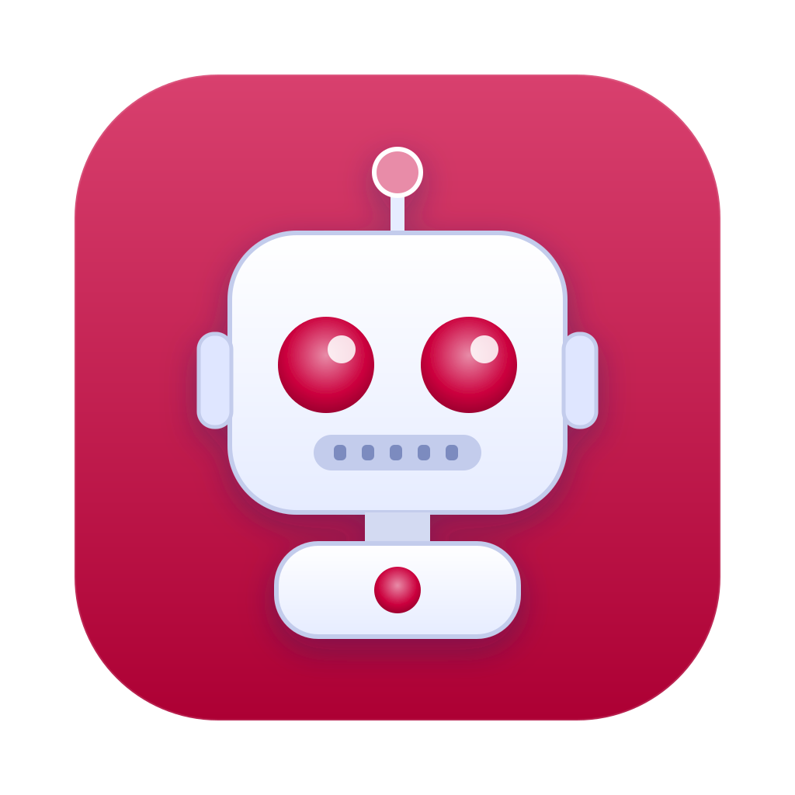

# customize-hermes-ui

Portable customizations for the [Hermes Agent](https://github.com/NousResearch/hermes-agent) desktop app. Everything here is generic: no specific color, path, or credential is baked in. Local choices (accent color, app path, backups) stay on each machine and are never committed.

## Contents

| Path | Purpose |
|---|---|
| `skills/hermes-robot-icon/` | Robot app icon with a configurable accent color (background, eyes, antenna tip, chest light) |

## Robot icon

The original robot is a white-bodied mascot on a rounded macOS-style tile. Only the accent color changes; the geometry and pale body are preserved. Rendering (SVG/PNG) works anywhere `rsvg-convert` exists; installing the icon into the app bundle is **macOS-only**.



### Install the skill into a Hermes instance

```sh
git clone https://github.com/KRRySS/customize-hermes-ui.git
cp -R customize-hermes-ui/skills/hermes-robot-icon "${HERMES_HOME:-$HOME/.hermes}/skills/"
```

Start a new Hermes session so the skill catalog picks it up. Full details, safety notes, and recovery steps are in `skills/hermes-robot-icon/references/INSTRUCTIONS.md`.

### Requirements

- Python 3.9+ (standard library only)
- `rsvg-convert` (macOS: `brew install librsvg`)
- macOS install path additionally needs `iconutil`, `codesign`, `ditto` (all ship with macOS)

### Quick use

```sh
cd skills/hermes-robot-icon
python3 scripts/robot_icon.py --render-only --accent '#2E7D32' --output preview   # preview first
python3 scripts/robot_icon.py --apply --app "/Applications/Hermes.app" --accent '#2E7D32'
python3 scripts/robot_icon.py --reapply     # after an app upgrade restores the stock icon
python3 scripts/test_robot_icon.py -v
```

Quote the accent (`'#RRGGBB'`) so the shell does not treat `#` as a comment. After a successful apply, quit and reopen the app yourself — the script never kills processes.

### What the installer does

Stages a full copy of the app bundle, replaces the bundle `.icns` and the runtime `apple-touch-icon.png` entries inside `app.asar` (preserving unpacked flags and integrity records), updates the Electron ASAR integrity hash, re-signs the bundle ad hoc, verifies everything, then swaps the copy into place. A timestamped full backup is kept under `$HERMES_HOME/custom-icon/backups`. Failures roll back.

Ad-hoc signing replaces the publisher signature, so macOS may ask you to re-grant permissions. Do not use on managed/protected installations without authorization.

### Known pitfalls (macOS)

- **Dock shows the old icon after quitting** — the running app sets a runtime icon; the closed app's tile uses the bundle `.icns` plus system caches. Check which bundle the Dock tile actually points to (`defaults export com.apple.dock -`), then `lsregister -f "$APP"`, `touch "$APP"`, `killall Dock`.
- **Not in Applications / Spotlight** — a source build inside a hidden directory is not an installed app. Copy it with `ditto` to `/Applications`, register it, and repoint the Dock tile. The instructions cover this step by step.

## Prompt for another Hermes instance

Paste this into a fresh Hermes session on the target machine, replacing `XXX` with a website URL (the agent extracts the site's primary color) or a hex color:

```text
Install the Hermes robot icon skill from https://github.com/KRRySS/customize-hermes-ui
(copy skills/hermes-robot-icon into $HERMES_HOME/skills/, then read its
references/INSTRUCTIONS.md before doing anything).

Accent color: derive the primary color of XXX. Prefer an official logo asset
or the site's CSS variables / dominant saturated UI color over screenshots; report the
hex you chose and why before using it. If XXX is already a #RRGGBB value, use it as-is.

Then:
1. Render a preview with --render-only and show me the PNG.
2. Ask me to confirm the exact Hermes.app bundle path to modify (do not guess; if the
   app runs from a hidden build directory, propose installing it into /Applications first).
3. Only after my confirmation run --apply with that path and accent.
4. Verify: signature valid, the bundle .icns is recolored, the Dock tile points at the
   modified bundle. Do not quit or restart the app yourself — tell me to do it.
5. Save nothing machine-specific into the skill directory.
```

## License

MIT — see `LICENSE`.
